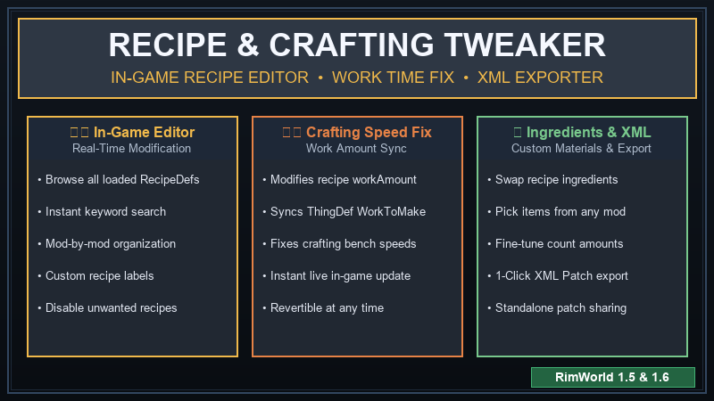

# 🛠️ Recipe & Crafting Tweaker for RimWorld



[-brightgreen.svg)](#)
[](#)
[](#)

**Recipe & Crafting Tweaker** is an in-game, real-time recipe and crafting editor for RimWorld. It allows you to inspect, modify, customize, and export any recipe (`RecipeDef`) from vanilla or loaded mods without ever leaving the game!

---

## ✨ Features

* **🔍 Real-Time In-Game Recipe Editor:** Search, filter, and inspect recipes organized by mod package.
* **⏱️ Crafting Speed / Work Amount Fix:** Modifies both the recipe's `workAmount` and the produced item's `WorkToMake` stat simultaneously, ensuring workbench crafting speeds actually reflect your changes.
* **📦 Custom Ingredient Picker:** Easily swap required materials, add new ingredients from any mod, or adjust quantity counts.
* **🚫 Disable Recipes:** Disable recipes you don't want your colonists or workbenches using.
* **📤 1-Click XML Patch Exporter:** Export your entire custom recipe configuration into a standalone RimWorld XML patch file (`Config/RecipeTweaker/GeneratedPatches.xml`) for permanent mod lists or sharing with friends!
* **🔄 Revert to Vanilla:** Single-click reset for individual recipes or all recipes at once with safe confirmation dialogs.
* **🌐 Multilingual:** Full English and Turkish (*Türkçe*) localization.

---

## 🎮 How to Use

1. Launch RimWorld and go to **Options ➔ Mod Settings ➔ Recipe & Crafting Tweaker**.
2. Click **"Open Recipe Editor"** to bring up the live recipe browser.
3. Search for any recipe by name in the search bar.
4. Customize work amount, change labels, add/remove ingredients using the item picker, or disable the recipe.
5. Click **"Save Changes"** — the tweak is applied instantly in-game!

## 📋 Requirements
- **RimWorld:** `1.5`, `1.6` or `1.7` (Beta)

---

## 📁 Installation

1. Download the latest release from the [Releases](https://github.com/SadSeal5/rimworld-recipe-tweaker/releases) page.
2. Extract the folder into your RimWorld `Mods` directory:
   ```
   RimWorld/Mods/RecipeTweaker/
   ```
3. Enable the mod in RimWorld's mod manager.
